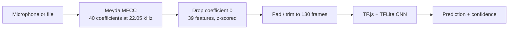
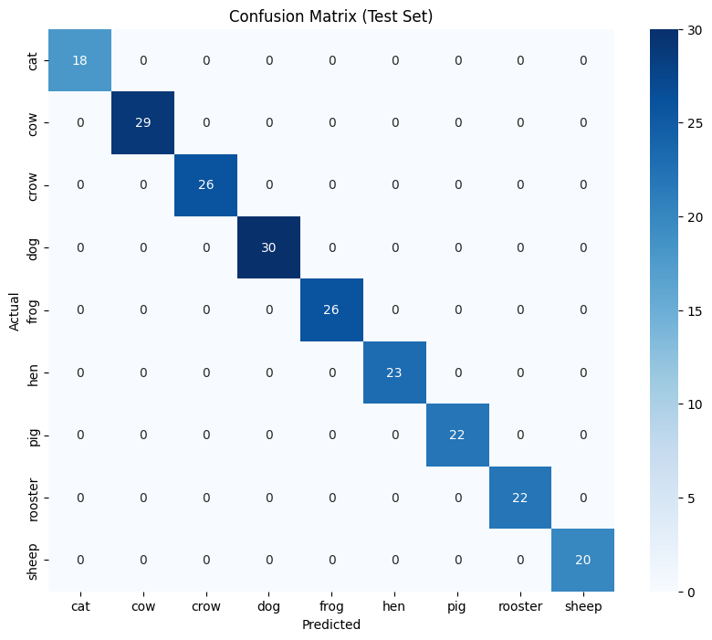
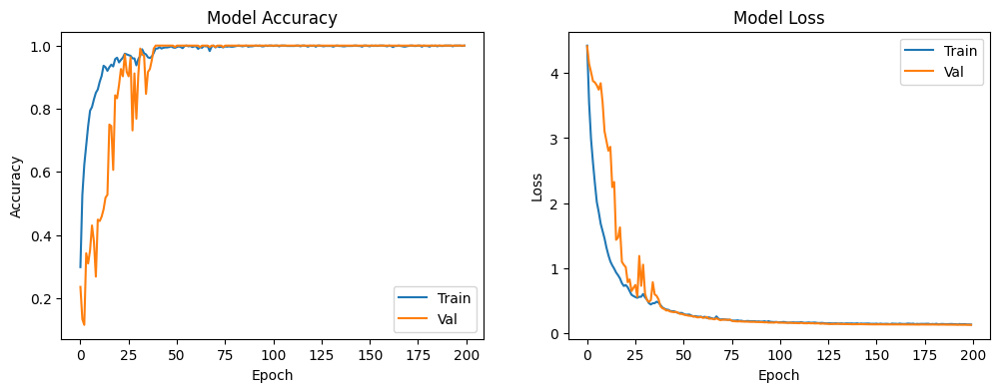
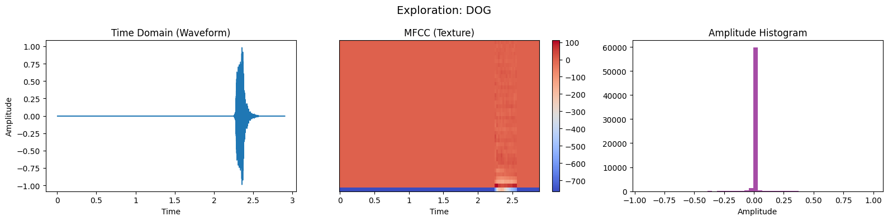

# EduAudio — Animal Sound Classifier for Kids

A browser toy that listens to a sound and guesses which animal made it — **cat, cow, crow,
dog, frog, hen, pig, rooster, sheep** — then shows the answer with an emoji.

The model is trained in Python (Keras) and exported to TensorFlow Lite, but the app itself
runs **entirely in the browser**: no server, no upload, no microphone audio ever leaves the
machine.

Coursework for the **Speech Recognition (AISPR)** module.


---

## Contents

- [What it does](#what-it-does)
- [Results](#results)
- [Dataset](#dataset)
- [Method](#method)
- [Repository structure](#repository-structure)
- [Getting started](#getting-started)
- [Model](#model)
- [Limitations](#limitations)
- [Data and ethics](#data-and-ethics)
- [Licence](#licence)

---

## What it does

Press record, make an animal noise (or play one of the reference sounds), and the page
names the animal.

Under the hood the page converts the microphone stream into MFCCs in real time with
[Meyda](https://meyda.js.org/), feeds a 130 × 39 image of the sound into a small CNN running
through [TensorFlow.js](https://www.tensorflow.org/js), and shows the top prediction with a
confidence bar.



The same preprocessing is implemented twice — once in Python (librosa) for training, once in
JavaScript (Meyda) for inference. Keeping the two identical is the whole engineering problem:
`lifter=0`, a 512-sample FFT, a 512-sample hop, dropping the 0th coefficient (volume) and
z-scoring per clip are all chosen so that a browser frame looks like a training frame.

---

## Results

> ⚠️ **Read the caveat first.** The 100 % below is *not* a measure of how well this
> generalises to new recordings — the augmentation step runs before the train/test split, so
> variants of the same clip end up on both sides. See [Limitations](#limitations) for the
> explanation and the fix.

| Metric | Value |
|---|---|
| Test samples | 216 |
| Accuracy | **1.00** |
| Macro F1 | 1.00 |
| Training epochs | 200 (no early stop) |
| Final validation loss | 0.126 |

Every class scores 1.00 precision and recall in the classification report, and the confusion
matrix is perfectly diagonal:



Training and validation both saturate within about 50 epochs:



### What the model "sees"

Each clip becomes an MFCC heatmap — a picture of how the sound's texture changes over time.
This is one dog clip as a waveform, its MFCCs, and its amplitude histogram:



---

## Dataset

**ESC-50**, a public collection of 2,000 five-second environmental recordings
([Piczak, 2015](https://github.com/karolpiczak/ESC-50)). This project uses the **360 clips**
belonging to nine animal categories, 40 per category.

| | |
|---|---|
| Clips used | 360 (9 classes × 40) |
| Format | 5 s, 44.1 kHz, mono, 16-bit — 441,044 bytes each |
| Loaded as | 22.05 kHz, first 2.9 s |
| Metadata | `eduaudio/dataset/esc50.csv` (the full 2,000-row ESC-50 index) |
| Licence | **CC BY-NC 3.0** — non-commercial only |

The clips are committed so the notebook runs after a clone, with no 600 MB download. The
licence and attribution are in [`eduaudio/dataset/README.md`](eduaudio/dataset/README.md).

---

## Method

### 1. Features

Each clip is loaded at 22.05 kHz for 2.9 s and converted to 40 MFCCs using
`n_fft=512`, `hop_length=512`, `lifter=0`. The 0th coefficient carries loudness rather than
timbre, so it is dropped, leaving **39 features**. The clip is then z-scored and padded or
trimmed to exactly **130 time frames** — so one sample is a `130 × 39 × 1` array.

### 2. Augmentation

Each of the 360 clips is expanded into three samples:

- the original,
- **noise** — Gaussian noise at 0.4 % of the clip's peak,
- **time shift** — the waveform rolled by up to ±30 % of its length.

That gives **1,080 samples**, split 80/20 into **864 train / 216 test**
(`random_state=7204`).

### 3. Network

A small 2-D CNN, deliberately regularised for a tiny dataset:

| Block | Layers |
|---|---|
| 1 | Conv2D 32 · BatchNorm · MaxPool · Dropout 0.3 |
| 2 | Conv2D 64 · BatchNorm · MaxPool · Dropout 0.4 |
| 3 | Conv2D 128 · BatchNorm · MaxPool · Dropout 0.4 |
| Head | GlobalAveragePooling · Dense 128 · Dropout 0.5 · Dense 9 softmax |

All convolutions use `l2(0.01)`. Trained with Adam, batch size 32, up to 200 epochs, with
`ReduceLROnPlateau` (factor 0.2, patience 5) and `EarlyStopping` (patience 15,
`restore_best_weights`).

GlobalAveragePooling is what makes the model shift-tolerant: it averages over time, so a
sound happening at 0.5 s or 2 s produces the same features.

### 4. Export

`TFLiteConverter.from_keras_model` writes `web_app/model.tflite` (439 KB), which the page
loads with `@tensorflow/tfjs-tflite`.

---

## Repository structure

```
.
├── eduaudio/
│   ├── eduaudio_model.ipynb        # training: EDA → features → CNN → evaluation → TFLite
│   ├── requirements.txt
│   ├── dataset/
│   │   ├── audio/                  # 360 ESC-50 clips (~151 MB)
│   │   ├── esc50.csv               # full ESC-50 metadata (2,000 rows)
│   │   ├── README.md               # provenance, licence, how the subset was chosen
│   │   └── LICENSE-CC-BY-NC-3.0.md
│   └── web_app/
│       ├── index.html              # the dashboard
│       ├── script.js               # Meyda → MFCC → TF.js inference
│       ├── style.css
│       ├── model.tflite            # trained model (439 KB)
│       └── assets/                 # one reference WAV per animal
├── docs/images/                    # figures exported from the notebook
├── LICENSE
└── README.md
```

---

## Getting started

### The web app (no Python needed)

```bash
cd eduaudio/web_app
python -m http.server 8000
```

Then open <http://localhost:8000> and allow microphone access.

It has to be served over HTTP rather than opened as a `file://` URL — the page fetches
`model.tflite`, which browsers block for local files.

### Retraining

```bash
python -m venv .venv
# Windows
.venv\Scripts\activate
# macOS / Linux
source .venv/bin/activate

pip install -r eduaudio/requirements.txt
jupyter lab eduaudio/eduaudio_model.ipynb
```

Run the cells from top to bottom. The last cell overwrites `web_app/model.tflite`.

The reference run — 200 epochs at roughly 14 s each, so about 45 minutes — used
Python 3.9.25, TensorFlow 2.10.0 and a CUDA GPU.

---

## Model

`web_app/model.tflite` is committed (439 KB), so the demo works straight from a clone — you
do not need to train anything to try it.

It expects a `float32` tensor of shape `[1, 130, 39, 1]` and returns nine class
probabilities in this order:

```
cat, cow, crow, dog, frog, hen, pig, rooster, sheep
```

---

## Limitations

**1. The test score is inflated by a split-order mistake.** This is the important one.

The notebook creates all three augmented variants first and only then calls
`train_test_split` on the 1,080 samples. Variants of the *same* recording therefore land on
both sides of the split: the probability that all three variants of a clip stay together is
`0.8³ + 0.2³ = 52 %`, so roughly **48 % of the clips have a near-copy in the test set**. The
model recognises them rather than generalising, which is why accuracy is exactly 1.00.

The fix is to split by source clip and augment only the training portion:

```python
train_df, test_df = train_test_split(subset, test_size=0.2, stratify=subset['category'])
# augment train_df, leave test_df untouched
```

The reported figures are what the submitted notebook produced and are left unchanged here.

**2. The dataset is small.** 40 clips per animal, from one curated collection, recorded
indoors on consumer devices. Real-world cat noises are shorter, quieter and much noisier.

**3. Training was not stopped early.** The model ran the full 200 epochs and never triggered
`EarlyStopping`; the final validation loss of 0.126 suggests it is fitting training noise
rather than converging.

**4. Browser and Python features are only approximately equal.** Meyda and librosa implement
MFCC slightly differently (windowing, mel filter banks, DCT scaling). The two were tuned by
hand to agree; small differences remain and will cost some accuracy on real recordings.

**5. Nine animals, nothing else.** Anything that is not one of those nine will still be
assigned to the nearest class with high confidence — there is no "unknown" threshold.

---

## Data and ethics

- The recordings are environmental sounds from ESC-50. **No human voices** are used, so no
  speaker data, names or transcripts exist anywhere in this project.
- The web app processes audio locally in the browser. Nothing is uploaded, stored or logged.
- This is a teaching demo for children, not a product: it is not trained on children's
  voices and makes no claims beyond the nine animals.

---

## Licence

- **Code and this README:** [MIT](LICENSE)
- **Dataset (`eduaudio/dataset/audio`):** [CC BY-NC 3.0](eduaudio/dataset/LICENSE-CC-BY-NC-3.0.md), © K. J. Piczak / Freesound contributors — **non-commercial use only**
- **`TensorFlow.js`, `tfjs-tflite`, `Meyda`:** Apache-2.0 / MIT, loaded from CDN

The MIT licence covers the code only. The bundled audio may not be used commercially.

---

## Acknowledgements

- K. J. Piczak, *ESC: Dataset for Environmental Sound Classification*, ACM Multimedia 2015
- [Freesound](https://freesound.org/) contributors, whose recordings make up ESC-50
- The TensorFlow.js and Meyda teams
- Font Awesome and the Fredoka typeface, used in the dashboard
